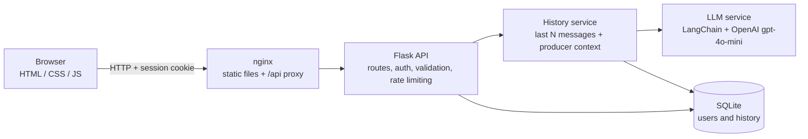

# SVDA

**A chatbot that gives small and medium cattle producers practical guidance on feeding, health and herd management, in plain Portuguese.**

[](https://github.com/tiagoosm/SVDA_Fetin/actions/workflows/ci.yml)

[](LICENSE)

🇧🇷 [Leia em português](README.pt-BR.md)

**SVDA** stands for *Sistema de Verificação de Dados Alimentícios Bovinos* (Bovine Feed Data Verification System). It was built by a team at the **44th FETIN** (Inatel's Technological Fair). Users sign up with their herd profile (type and size), log in and chat with an assistant specialised in cattle nutrition, health and farm management.

> ⚠️ The assistant's answers are guidance only. They do **not** replace a veterinarian or an animal-science professional.

## Screenshots

Running application (chat screen):


Design mockups from the design phase (the final UI may differ slightly):

| Login | Sign up |
| --- | --- |
|  |  |
| **Conversations** | **Chat** |
|  |  |

## Features

- Sign-up with name, e-mail, password, herd size (small / medium / large) and cattle type (dairy / beef / other).
- Login and logout with a server-side session (HttpOnly cookie). Every conversation belongs to one user and cannot be read by another.
- Chat with an LLM assistant (OpenAI `gpt-4o-mini`) that answers in simple, short Portuguese about feed formulation, supplementation, dry/wet season management, vaccination and general farm routine.
- The assistant receives one line of context about the producer (cattle type and herd size), taken from closed lists only.
- Conversation history is stored in SQLite; you can list past conversations and reopen them. A new conversation starts with a clean context.
- Markdown answers rendered safely (sanitised with DOMPurify) with a typing effect.
- Visible notice in the chat that answers are guidance and do not replace a professional.

## Tech stack

| Layer | Technology |
| --- | --- |
| Frontend | HTML, CSS and JavaScript (no framework), [marked](https://marked.js.org/) and [DOMPurify](https://github.com/cure53/DOMPurify) (vendored) |
| API | Python, Flask, Flask-CORS, Flask-Limiter, gunicorn |
| LLM layer | LangChain (`langchain-core`, `langchain-openai`), OpenAI `gpt-4o-mini` |
| Database | SQLite |
| Tooling | pytest, pytest-cov, ruff, GitHub Actions, Docker Compose, nginx |
| Design | Figma |

## Architecture



Without Docker the browser talks to the Flask API directly, and the static files can be served by any web server. Each `/mensagem` request makes exactly **one** call to the model.

## Getting started

You need Python 3.12+ and an [OpenAI API key](https://platform.openai.com/api-keys). The OpenAI API is paid; see [Cost control](#technical-decisions).

### Local

```bash
git clone https://github.com/tiagoosm/SVDA_Fetin.git
cd SVDA_Fetin
python -m venv .venv && source .venv/bin/activate
pip install -r requirements.txt
cp .env.example .env        # then set OPENAI_API_KEY in .env
python -m api               # API on http://localhost:5000
```

In a second terminal, serve the frontend:

```bash
python -m http.server 8080 --directory interface
```

Open <http://localhost:8080>. In development (`APP_ENV=development`, the value in `.env.example`) a random `SECRET_KEY` is generated if you leave it empty, so sessions are lost whenever the server restarts.

### Docker

```bash
cp .env.example .env        # set OPENAI_API_KEY and SECRET_KEY
docker compose up --build
```

Open <http://localhost:8080>. nginx serves the frontend and proxies `/api/` to the backend, so there is no CORS setup. Data is kept in the `svda-data` volume. Generate a secret key with `python -c "import secrets; print(secrets.token_hex(32))"`. When serving over HTTPS, set `SESSION_COOKIE_SECURE=true`.

## Environment variables

All variables are optional in development except the OpenAI key. See [`.env.example`](.env.example) for the full, commented list.

| Variable | Default | Purpose |
| --- | --- | --- |
| `OPENAI_API_KEY` | – | OpenAI key for the chatbot (never commit it) |
| `SECRET_KEY` | – | Signs the session cookie. **Required** when `APP_ENV=production` |
| `APP_ENV` | `production` | `production`, `development` or `testing` |
| `DATABASE_PATH` | `banco.db` | SQLite file (relative paths resolve from the project root) |
| `CORS_ORIGINS` | dev origins | Comma-separated allowed frontend origins (`*` is rejected) |
| `SESSION_COOKIE_SAMESITE` / `SESSION_COOKIE_SECURE` | `Lax` / `true` in production | Session cookie flags |
| `HISTORY_MAX_MESSAGES` | `10` | Previous messages sent to the model |
| `MAX_MESSAGE_CHARS` | `2000` | Maximum size of a user message |
| `LLM_MAX_TOKENS` | `1024` | Maximum tokens in each answer |
| `RATE_LIMIT_LOGIN` / `RATE_LIMIT_REGISTER` / `RATE_LIMIT_MESSAGE` | `5 per minute;30 per hour` / `10 per hour` / `10 per minute;200 per day` | Rate limits (`/mensagem` is limited per user) |
| `LOG_FORMAT`, `LOG_LEVEL` | `text`, `INFO` | `LOG_FORMAT=json` prints one JSON object per line |

The frontend finds the API through [`interface/config.js`](interface/config.js) (the only place the API URL is defined).

## API

| Method | Route | Auth | Description |
| --- | --- | --- | --- |
| POST | `/register` | – | Create an account (e-mail, password, name, herd size, cattle type) |
| POST | `/login` | – | Start a session |
| POST | `/logout` | ✔ | End the session |
| GET | `/me` | ✔ | Current user profile |
| POST | `/mensagem` | ✔ | Send a message; returns the answer and the `conversa_id` |
| GET | `/conversas` | ✔ | List the user's conversations |
| GET | `/historico?conversa_id=…` | ✔ | Messages of one conversation |

The user is always taken from the session, never from request parameters. Errors are JSON: `{"erro": "..."}`.

## Tests and quality

```bash
pip install -r requirements-dev.txt
pytest --cov=api            # 69 tests, ~97% coverage
ruff check . && ruff format --check .
```

The tests never call OpenAI: the LLM is replaced by a fake that records the messages it receives. They cover sign-up and login, access control (including a regression test that user A cannot read user B's data), input validation, rate limiting, history limits, the exact message format sent to the model, the data layer and error handling. CI (GitHub Actions) runs lint and tests on every push and pull request.

## Project structure

```text
api/
  __init__.py          create_app() factory
  config.py            environment variables, validated at startup
  security.py          login_required and input validation
  routes/              auth, chat and conversations blueprints
  services/            llm (prompt + model call) and history (memory, producer context)
  db/                  connection, schema/migrations and repositories
  prompts/system_prompt.md
interface/             static frontend (pages, config.js, api.js, vendor/)
tests/                 pytest suite
docs/                  visual guide, design notes and screenshots
docker/                nginx config and frontend image
.github/workflows/     CI
```

## Technical decisions

- **Server-side sessions.** The browser only holds an HttpOnly cookie; the server decides who the user is. An early version trusted a user id sent by the client, which allowed reading other users' history. This is now covered by a regression test.
- **Conversation memory rebuilt from the database.** The model's context is built per (user, conversation) from the `historico` table, so it survives restarts and a new conversation does not inherit an old one.
- **Cost control.** The OpenAI API is paid, so each request is bounded: only the last `HISTORY_MAX_MESSAGES` messages are sent, user messages are capped at `MAX_MESSAGE_CHARS`, answers at `LLM_MAX_TOKENS`, and login and `/mensagem` are rate limited. There is exactly one model call per message and no extra calls (titles, summaries, moderation).
- **No prompt injection through the profile.** Cattle type and herd size are validated against closed lists before they reach the prompt.
- **Safe defaults.** Debug is off, the server binds to `127.0.0.1`, CORS uses an allow-list, and the app refuses to start in production without `SECRET_KEY`.

## Known limitations

- The assistant uses a paid third-party LLM API and needs internet access and an API key.
- Its knowledge is a static system prompt, not a retrieval system. Technical content (for example the vaccination guidance) is **not validated by a veterinarian** and may be out of date.
- The in-memory rate limiter is per process; with more than one server process, use Redis (`RATELIMIT_STORAGE_URI`).
- No password recovery and no e-mail verification.
- SQLite is fine for a demo or small deployment, not for heavy concurrent use.
- Answers are returned whole and then "typed" in the browser; there is no streaming.
- Frontend code has no automated tests; it was checked manually in a browser.
- The online demo is the static frontend only (see below).

## Online demo

<https://svda-tiagoosms-projects.vercel.app/> hosts only the **static frontend**. The backend is not deployed there, so sign-up, login and the chat do not work on that page. To try the whole system, run it locally or with Docker as above.

## Roadmap

Ideas, not commitments:

- Host the backend so the online demo is fully working.
- Review the assistant's technical content with a professional and keep the vaccination calendar up to date.
- Password recovery and the "location" field planned in the original sign-up design.
- Streaming answers.
- Redis-backed rate limiting and a production database.
- Automated frontend tests.

## Team

Project developed by a group at the 44th FETIN (Inatel).

- <PREENCHER>
- <PREENCHER>
- <PREENCHER>

My role: <PREENCHER>

## License

[MIT](LICENSE) © Tiago da Silva Machado
