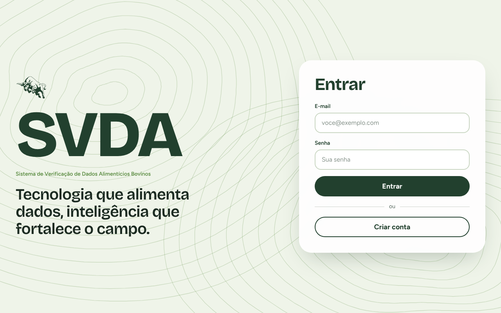
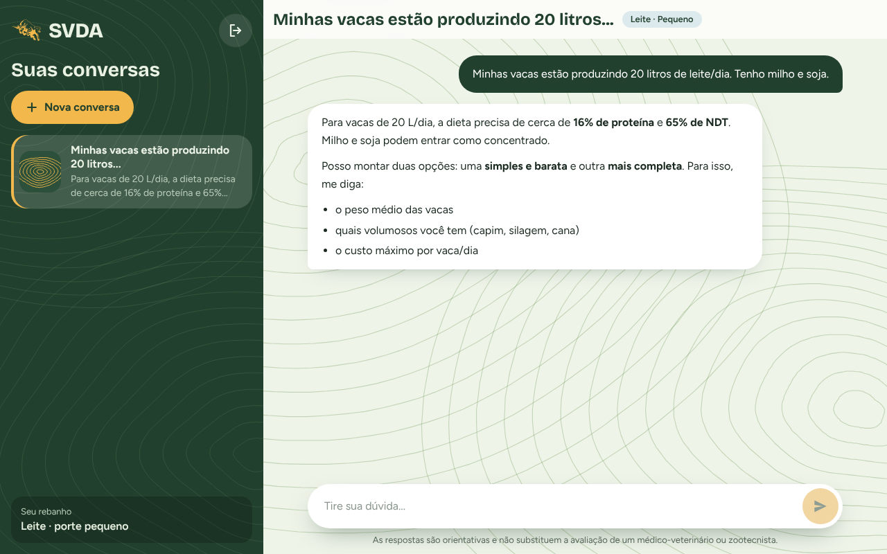
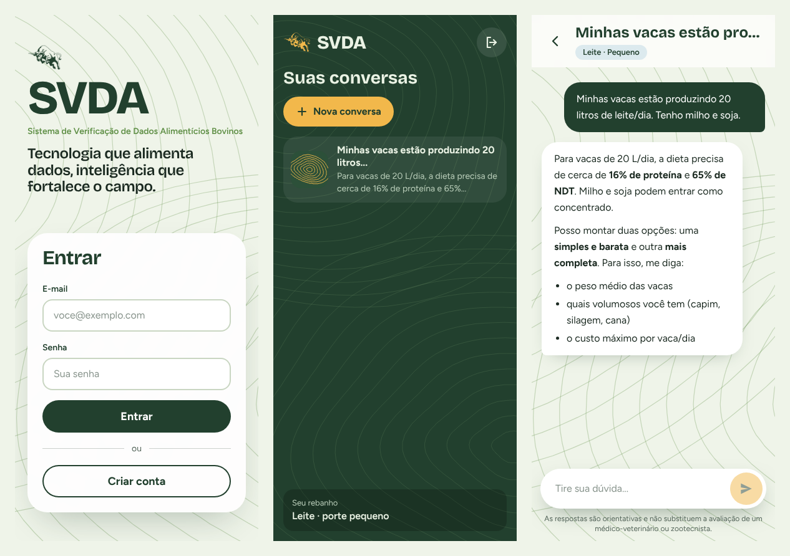
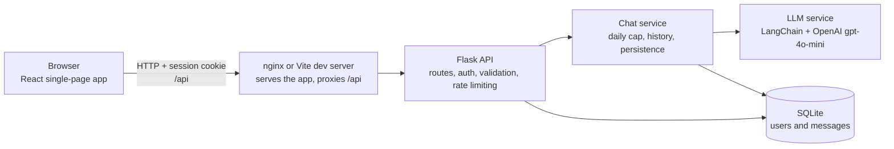

# SVDA

**A chatbot that gives small and medium cattle producers practical guidance on feeding, health and herd management, in plain Portuguese.**

[](https://github.com/tiagoosm/SVDA_Fetin/actions/workflows/ci.yml)


[](LICENSE)

🇧🇷 [Leia em português](README.pt-BR.md)

**SVDA** stands for _Sistema de Verificação de Dados Alimentícios Bovinos_ (Bovine Feed Data Verification System). It was built by a team at the **44th FETIN** (Inatel's Technological Fair). Users sign up with their herd profile (cattle type and size), log in and chat with an assistant specialised in cattle nutrition, health and farm management.

> ⚠️ The assistant's answers are guidance only. They do **not** replace a veterinarian or an animal-science professional.

## Screenshots

|                                                    |                                                  |
| -------------------------------------------------- | ------------------------------------------------ |
|  |  |



_The assistant's answer in these captures is a sample, produced with a mocked model, not a real OpenAI response. The interface is responsive: phones show one pane at a time; tablets and wider screens show the conversation list and the chat side by side._

## Features

- Sign-up with name, e-mail, password, cattle type (dairy / beef / other) and herd size (small / medium / large).
- Login and logout with a server-side session (HttpOnly cookie). Every conversation belongs to one user and cannot be read by another.
- Chat with an LLM assistant (OpenAI `gpt-4o-mini`) that answers in simple, short Portuguese about feed formulation, supplementation, dry/wet season management, vaccination and general farm routine.
- The assistant receives one line of context about the producer (cattle type and herd size), taken from closed lists only.
- Conversation history stored in SQLite: list past conversations and reopen them. A new conversation starts with a clean context.
- Markdown answers rendered safely (raw HTML is never interpreted), with a typing effect that respects the reduced-motion setting.
- Visible notice in the chat that answers are guidance and do not replace a professional.
- Responsive interface (phone, tablet, desktop) with a visual identity built around contour lines.

## Tech stack

| Layer      | Technology                                                                                          |
| ---------- | --------------------------------------------------------------------------------------------------- |
| Frontend   | React 19, TypeScript, Vite, Tailwind CSS 4, React Router, react-markdown                            |
| API        | Python, Flask, Flask-CORS, Flask-Limiter, gunicorn                                                  |
| LLM layer  | LangChain (`langchain-core`, `langchain-openai`), OpenAI `gpt-4o-mini`                              |
| Database   | SQLite                                                                                              |
| Tooling    | pytest, ruff, Vitest, Testing Library, ESLint, Prettier, GitHub Actions, Docker Compose, nginx      |

## Architecture



The frontend always calls the API under `/api` on its own origin, so there is no CORS and the session cookie is a plain first-party cookie. Each message makes exactly **one** call to the model.

## Getting started

You need Python 3.12+, Node.js 22+ and an [OpenAI API key](https://platform.openai.com/api-keys). The OpenAI API is paid; see [Technical decisions](#technical-decisions).

### Local development

```bash
git clone https://github.com/tiagoosm/SVDA_Fetin.git
cd SVDA_Fetin
cp .env.example .env              # then set OPENAI_API_KEY in .env

# Terminal 1: backend (http://localhost:5000)
cd backend
python -m venv .venv && source .venv/bin/activate
pip install -r requirements.txt
python -m app

# Terminal 2: frontend (http://localhost:5173)
cd frontend
npm ci
npm run dev
```

Open <http://localhost:5173>. In development (`APP_ENV=development`, the value in `.env.example`) a random `SECRET_KEY` is generated if you leave it empty, so sessions are lost whenever the backend restarts. The Vite dev server proxies `/api` to the backend.

### Docker

```bash
cp .env.example .env              # set OPENAI_API_KEY and SECRET_KEY
docker compose up --build
```

Open <http://localhost:8080>. nginx serves the built app and proxies `/api/` to the backend. Data is kept in the `svda-data` volume. Generate a secret key with `python -c "import secrets; print(secrets.token_hex(32))"`. When serving over HTTPS, set `SESSION_COOKIE_SECURE=true`.

## Environment variables

Everything is optional in development except the OpenAI key. [`.env.example`](.env.example) has the full, commented list.

| Variable                                                          | Default                                                  | Purpose                                                                  |
| ----------------------------------------------------------------- | -------------------------------------------------------- | ------------------------------------------------------------------------ |
| `OPENAI_API_KEY`                                                  | –                                                        | OpenAI key for the chatbot (never commit it)                             |
| `SECRET_KEY`                                                      | –                                                        | Signs the session cookie. **Required** when `APP_ENV=production`         |
| `APP_ENV`                                                         | `production`                                             | `production`, `development` or `testing`                                 |
| `DATABASE_PATH`                                                   | `data/svda.db`                                           | SQLite file (relative paths resolve from `backend/`)                     |
| `CORS_ORIGINS`                                                    | dev origins                                              | Allowed frontend origins (`*` is rejected)                               |
| `SESSION_COOKIE_SAMESITE` / `SESSION_COOKIE_SECURE`               | `Lax` / `true` in production                             | Session cookie flags                                                     |
| `HISTORY_MAX_MESSAGES`                                            | `10`                                                     | Previous messages sent to the model                                      |
| `MAX_MESSAGE_CHARS`                                               | `2000`                                                   | Maximum size of a user message                                           |
| `LLM_MAX_TOKENS`                                                  | `1024`                                                   | Maximum tokens in each answer                                            |
| `RATE_LIMIT_LOGIN` / `RATE_LIMIT_REGISTER` / `RATE_LIMIT_MESSAGE` | `5 per minute;30 per hour` / `10 per hour` / `10 per minute;200 per day` | Rate limits (messages are limited per user)                  |
| `INVITE_CODE` / `DAILY_MESSAGE_LIMIT`                             | – / `0`                                                  | Public-demo protection: sign-up code and a global daily message cap      |
| `LOG_FORMAT`, `LOG_LEVEL`                                         | `text`, `INFO`                                           | `LOG_FORMAT=json` prints one JSON object per line                        |

The frontend reads `VITE_API_BASE_URL` (default `/api`) and `VITE_DEV_API_TARGET` (default `http://localhost:5000`); see [`frontend/.env.example`](frontend/.env.example).

## API

| Method | Route                                | Auth | Description                                                               |
| ------ | ------------------------------------ | ---- | ------------------------------------------------------------------------- |
| POST   | `/auth/register`                     | –    | Create an account (e-mail, password, name, cattle type, herd size)        |
| POST   | `/auth/login`                        | –    | Start a session                                                           |
| POST   | `/auth/logout`                       | ✔    | End the session                                                           |
| GET    | `/auth/me`                           | ✔    | Current user profile                                                      |
| GET    | `/conversations`                     | ✔    | List the user's conversations                                             |
| GET    | `/conversations/{id}/messages`       | ✔    | Messages of one conversation                                              |
| POST   | `/conversations/{id}/messages`       | ✔    | Send a message; the conversation id is a UUID chosen by the client        |
| GET    | `/config`                            | –    | Public settings the client needs (whether sign-up requires an invite)     |
| GET    | `/health`                            | –    | Health check                                                              |

The user always comes from the session, never from request parameters. Errors are JSON: `{"error": "..."}`.

## Tests and quality

```bash
# Backend
cd backend
pip install -r requirements-dev.txt
pytest --cov=app                  # 85 tests, ~97% coverage
ruff check . && ruff format --check .

# Frontend
cd frontend
npm run lint && npm run format:check && npm run typecheck
npm test                          # 39 tests
npm run build
```

The tests never call OpenAI: the LLM is replaced by a fake that records the messages it receives. They cover sign-up and login, access control (including a regression test that user A cannot read user B's data), input validation, rate limiting, history limits, the exact message format sent to the model, the data layer, database migration and error handling. Frontend tests cover the API client, the login, sign-up and chat flows, session expiry and a check that HTML in answers is never executed. CI (GitHub Actions) runs both suites on every push and pull request.

## Project structure

```text
backend/
  app/
    __init__.py            create_app() factory
    config.py              environment variables, validated at startup
    auth.py, validation.py login_required and input validation
    routes/                meta, auth and conversations blueprints
    services/              chat (daily cap, history, persistence), llm, history
    db/                    connection, schema + migrations, repositories
    prompts/system_prompt.md
  tests/                   pytest suite
  Dockerfile, wsgi.py
frontend/
  src/
    features/auth, chat    pages, hooks and components by feature
    components/ui          buttons, fields, icons, contour art
    context, routes        auth state and route guards
    lib, types, styles     API client, helpers, Tailwind theme
  Dockerfile, nginx.conf
docs/                      design notes and screenshots
.github/workflows/         CI
docker-compose.yml, .env.example
```

## Technical decisions

- **Server-side sessions.** The browser only holds an HttpOnly cookie; the server decides who the user is. An early version trusted a user id sent by the client, which allowed reading other users' history. This is now covered by a regression test.
- **Conversation memory rebuilt from the database.** The model's context is built per (user, conversation) from the `messages` table, so it survives restarts and a new conversation does not inherit an old one.
- **Cost control.** The OpenAI API is paid, so each request is bounded: only the last `HISTORY_MAX_MESSAGES` messages are sent, user messages are capped at `MAX_MESSAGE_CHARS`, answers at `LLM_MAX_TOKENS`, and login and message sending are rate limited. There is exactly one model call per message and no extra calls (titles, summaries, moderation). Answers cut by the token limit are flagged in the chat and logged.
- **No prompt injection through the profile.** Cattle type and herd size are validated against closed lists before they reach the prompt.
- **Safe rendering.** Answers are rendered by react-markdown, which never interprets raw HTML, so model output cannot inject scripts.
- **Safe defaults.** Debug is off, the server binds to `127.0.0.1`, CORS uses an allow-list, and the app refuses to start in production without `SECRET_KEY`.
- **Same-origin API.** Both the Vite dev server and nginx proxy `/api`, which avoids CORS and third-party-cookie problems.
- **Self-hosted fonts.** Fonts ship with the app through npm packages, with no requests to third-party servers.
- **Upgrading from an older version.** Databases created by earlier versions (Portuguese table and column names) are migrated in place on start, keeping users and history. The default database moved to `backend/data/svda.db`; set `DATABASE_PATH` to keep using an existing file.

## Known limitations

- The assistant uses a paid third-party LLM API and needs internet access and an API key.
- Its knowledge is a static system prompt, not a retrieval system. Technical content (for example the vaccination guidance) is **not validated by a veterinarian** and may be out of date.
- The in-memory rate limiter is per process; with more than one server process, use Redis (`RATELIMIT_STORAGE_URI`).
- No password recovery and no e-mail verification.
- SQLite is fine for a demo or a small deployment, not for heavy concurrent use.
- Answers are returned whole and then "typed" in the browser; there is no streaming.
- There are no browser-level end-to-end tests in CI.
- There is no hosted demo: run it locally or with Docker.

## Roadmap

Ideas, not commitments:

- Review the assistant's technical content with a professional and keep the vaccination calendar up to date.
- Password recovery and the "location" field planned in the original sign-up design.
- Streaming answers.
- Redis-backed rate limiting and a production database.
- End-to-end browser tests in CI.
- A hosted demo.

## License

[MIT](LICENSE)
