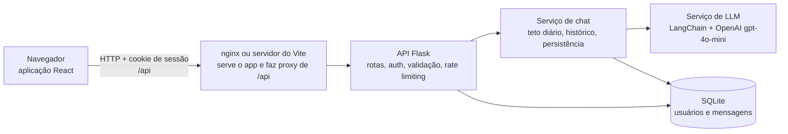

# SVDA

**Um chatbot que dá orientação prática a pequenos e médios produtores de gado sobre alimentação, saúde e manejo do rebanho, em português simples.**

[](https://github.com/tiagoosm/SVDA_Fetin/actions/workflows/ci.yml)


[](LICENSE)

🇬🇧 [Read in English](README.md)

**SVDA** significa _Sistema de Verificação de Dados Alimentícios Bovinos_. O projeto foi desenvolvido em grupo na **44ª FETIN** (Feira Tecnológica do Inatel). O usuário se cadastra com o perfil do rebanho (tipo de gado e porte), faz login e conversa com um assistente especializado em nutrição, saúde e manejo de bovinos.

> ⚠️ As respostas do assistente são apenas orientativas. Elas **não substituem** um médico-veterinário ou zootecnista.

## Telas

|                                                                |                                                       |
| -------------------------------------------------------------- | ----------------------------------------------------- |
|  |  |


_A resposta do assistente nestas capturas é um exemplo, gerado com um modelo simulado, e não uma resposta real da OpenAI. A interface é responsiva: no celular aparece um painel por vez; em tablets e telas maiores, a lista de conversas e o chat ficam lado a lado._

## Funcionalidades

- Cadastro com nome, e-mail, senha, tipo de gado (leite / corte / outro) e tamanho do rebanho (pequeno / médio / grande).
- Login e logout com sessão no servidor (cookie HttpOnly). Cada conversa pertence a um único usuário e não pode ser lida por outro.
- Chat com um assistente baseado em LLM (OpenAI `gpt-4o-mini`) que responde em português simples e direto sobre formulação de dietas, suplementação, manejo na seca e nas águas, vacinação e rotina da fazenda.
- O assistente recebe uma linha de contexto sobre o produtor (tipo de gado e porte do rebanho), vinda apenas de listas fechadas.
- Histórico salvo no SQLite: é possível listar e reabrir conversas anteriores. Uma nova conversa começa com o contexto limpo.
- Respostas em markdown renderizadas com segurança (HTML bruto nunca é interpretado) e efeito de digitação que respeita a configuração de movimento reduzido.
- Aviso visível no chat de que as respostas são orientativas e não substituem um profissional.
- Interface responsiva (celular, tablet e desktop), com uma identidade visual construída em torno de curvas de nível.

## Tecnologias

| Camada         | Tecnologia                                                                                            |
| -------------- | ----------------------------------------------------------------------------------------------------- |
| Frontend       | React 19, TypeScript, Vite, Tailwind CSS 4, React Router, react-markdown                              |
| API            | Python, Flask, Flask-CORS, Flask-Limiter, gunicorn                                                    |
| Camada de LLM  | LangChain (`langchain-core`, `langchain-openai`), OpenAI `gpt-4o-mini`                                |
| Banco de dados | SQLite                                                                                                |
| Ferramentas    | pytest, ruff, Vitest, Testing Library, ESLint, Prettier, GitHub Actions, Docker Compose, nginx        |

## Arquitetura



O frontend sempre chama a API em `/api`, na própria origem, então não há CORS e o cookie de sessão é um cookie comum de primeira parte. Cada mensagem faz exatamente **uma** chamada ao modelo.

## Como rodar

Você precisa de Python 3.12+, Node.js 22+ e de uma [chave da API da OpenAI](https://platform.openai.com/api-keys). A API da OpenAI é paga; veja [Decisões técnicas](#decisões-técnicas).

### Desenvolvimento local

```bash
git clone https://github.com/tiagoosm/SVDA_Fetin.git
cd SVDA_Fetin
cp .env.example .env              # depois defina OPENAI_API_KEY no .env

# Terminal 1: backend (http://localhost:5000)
cd backend
python -m venv .venv && source .venv/bin/activate
pip install -r requirements.txt
python -m app

# Terminal 2: frontend (http://localhost:5173)
cd frontend
npm ci
npm run dev
```

Abra <http://localhost:5173>. Em desenvolvimento (`APP_ENV=development`, valor do `.env.example`), se `SECRET_KEY` ficar vazia o backend gera uma chave aleatória, então as sessões se perdem a cada reinício. O servidor do Vite faz proxy de `/api` para o backend.

### Docker

```bash
cp .env.example .env              # defina OPENAI_API_KEY e SECRET_KEY
docker compose up --build
```

Abra <http://localhost:8080>. O nginx serve o app já compilado e faz proxy de `/api/` para o backend. Os dados ficam no volume `svda-data`. Gere uma chave com `python -c "import secrets; print(secrets.token_hex(32))"`. Ao servir por HTTPS, defina `SESSION_COOKIE_SECURE=true`.

## Variáveis de ambiente

Tudo é opcional em desenvolvimento, exceto a chave da OpenAI. A lista completa e comentada está em [`.env.example`](.env.example).

| Variável                                                          | Padrão                                                   | Função                                                                   |
| ----------------------------------------------------------------- | -------------------------------------------------------- | ------------------------------------------------------------------------ |
| `OPENAI_API_KEY`                                                  | –                                                        | Chave da OpenAI para o chatbot (nunca versione)                          |
| `SECRET_KEY`                                                      | –                                                        | Assina o cookie de sessão. **Obrigatória** com `APP_ENV=production`      |
| `APP_ENV`                                                         | `production`                                             | `production`, `development` ou `testing`                                 |
| `DATABASE_PATH`                                                   | `data/svda.db`                                           | Arquivo SQLite (caminhos relativos partem de `backend/`)                 |
| `CORS_ORIGINS`                                                    | origens de dev                                           | Origens do frontend permitidas (`*` é recusado)                          |
| `SESSION_COOKIE_SAMESITE` / `SESSION_COOKIE_SECURE`               | `Lax` / `true` em produção                               | Flags do cookie de sessão                                                |
| `HISTORY_MAX_MESSAGES`                                            | `10`                                                     | Mensagens anteriores enviadas ao modelo                                  |
| `MAX_MESSAGE_CHARS`                                               | `2000`                                                   | Tamanho máximo de uma mensagem do usuário                                |
| `LLM_MAX_TOKENS`                                                  | `1024`                                                   | Máximo de tokens em cada resposta                                        |
| `RATE_LIMIT_LOGIN` / `RATE_LIMIT_REGISTER` / `RATE_LIMIT_MESSAGE` | `5 per minute;30 per hour` / `10 per hour` / `10 per minute;200 per day` | Limites de requisições (mensagens são limitadas por usuário) |
| `INVITE_CODE` / `DAILY_MESSAGE_LIMIT`                             | – / `0`                                                  | Proteção de demo pública: código de cadastro e teto global diário        |
| `LOG_FORMAT`, `LOG_LEVEL`                                         | `text`, `INFO`                                           | `LOG_FORMAT=json` imprime um objeto JSON por linha                       |

O frontend lê `VITE_API_BASE_URL` (padrão `/api`) e `VITE_DEV_API_TARGET` (padrão `http://localhost:5000`); veja [`frontend/.env.example`](frontend/.env.example).

## API

| Método | Rota                                 | Auth | Descrição                                                                 |
| ------ | ------------------------------------ | ---- | ------------------------------------------------------------------------- |
| POST   | `/auth/register`                     | –    | Cria a conta (e-mail, senha, nome, tipo de gado, porte do rebanho)        |
| POST   | `/auth/login`                        | –    | Inicia a sessão                                                           |
| POST   | `/auth/logout`                       | ✔    | Encerra a sessão                                                          |
| GET    | `/auth/me`                           | ✔    | Perfil do usuário atual                                                   |
| GET    | `/conversations`                     | ✔    | Lista as conversas do usuário                                             |
| GET    | `/conversations/{id}/messages`       | ✔    | Mensagens de uma conversa                                                 |
| POST   | `/conversations/{id}/messages`       | ✔    | Envia uma mensagem; o id da conversa é um UUID escolhido pelo cliente     |
| GET    | `/config`                            | –    | Configurações públicas de que o cliente precisa (se o cadastro exige convite) |
| GET    | `/health`                            | –    | Health check                                                              |

O usuário vem sempre da sessão, nunca de parâmetros da requisição. Os erros são JSON: `{"error": "..."}`.

## Testes e qualidade

```bash
# Backend
cd backend
pip install -r requirements-dev.txt
pytest --cov=app                  # 85 testes, ~97% de cobertura
ruff check . && ruff format --check .

# Frontend
cd frontend
npm run lint && npm run format:check && npm run typecheck
npm test                          # 39 testes
npm run build
```

Os testes nunca chamam a OpenAI: o LLM é substituído por um falso que registra as mensagens recebidas. Eles cobrem cadastro e login, controle de acesso (incluindo o teste de regressão de que o usuário A não lê os dados do usuário B), validação de entrada, rate limiting, limite de histórico, o formato exato das mensagens enviadas ao modelo, a camada de dados, a migração do banco e o tratamento de erros. Os testes do frontend cobrem o cliente da API, os fluxos de login, cadastro e chat, a expiração da sessão e a garantia de que HTML nas respostas nunca é executado. O CI (GitHub Actions) roda as duas suítes a cada push e pull request.

## Estrutura do projeto

```text
backend/
  app/
    __init__.py            app factory create_app()
    config.py              variáveis de ambiente, validadas na inicialização
    auth.py, validation.py login_required e validação de entrada
    routes/                blueprints de meta, auth e conversas
    services/              chat (teto diário, histórico, persistência), llm, history
    db/                    conexão, schema + migrações, repositórios
    prompts/system_prompt.md
  tests/                   suíte pytest
  Dockerfile, wsgi.py
frontend/
  src/
    features/auth, chat    páginas, hooks e componentes por funcionalidade
    components/ui          botões, campos, ícones, arte de curvas de nível
    context, routes        estado de autenticação e guardas de rota
    lib, types, styles     cliente da API, utilitários, tema do Tailwind
  Dockerfile, nginx.conf
docs/                      notas de design e screenshots
.github/workflows/         CI
docker-compose.yml, .env.example
```

## Decisões técnicas

- **Sessão no servidor.** O navegador guarda apenas um cookie HttpOnly; quem decide o usuário é o servidor. Uma versão inicial confiava em um ID de usuário enviado pelo cliente, o que permitia ler o histórico de outras pessoas. Isso agora tem teste de regressão.
- **Memória da conversa reconstruída do banco.** O contexto do modelo é montado por (usuário, conversa) a partir da tabela `messages`, então sobrevive a reinícios e uma nova conversa não herda a anterior.
- **Controle de custo.** A API da OpenAI é paga, então cada requisição tem limites: só as últimas `HISTORY_MAX_MESSAGES` mensagens são enviadas, a mensagem do usuário é limitada a `MAX_MESSAGE_CHARS`, a resposta a `LLM_MAX_TOKENS`, e login e envio de mensagens têm rate limiting. Há exatamente uma chamada ao modelo por mensagem, sem chamadas extras (títulos, resumos, moderação). Respostas cortadas pelo limite de tokens são sinalizadas no chat e registradas no log.
- **Sem injeção de prompt pelo perfil.** Tipo de gado e porte do rebanho são validados contra listas fechadas antes de chegarem ao prompt.
- **Renderização segura.** As respostas são renderizadas pelo react-markdown, que nunca interpreta HTML bruto, então a saída do modelo não consegue injetar scripts.
- **Padrões seguros.** Debug desligado, servidor em `127.0.0.1`, CORS com lista de origens permitidas, e o app se recusa a iniciar em produção sem `SECRET_KEY`.
- **API na mesma origem.** O servidor do Vite e o nginx fazem proxy de `/api`, o que evita CORS e problemas com cookies de terceiros.
- **Fontes embutidas.** As fontes vêm junto com o app por pacotes do npm, sem requisições a servidores de terceiros.
- **Atualizando de uma versão antiga.** Bancos criados por versões anteriores (tabelas e colunas em português) são migrados no próprio arquivo ao iniciar, mantendo usuários e histórico. O banco padrão passou a ser `backend/data/svda.db`; defina `DATABASE_PATH` para continuar usando um arquivo existente.

## Limitações conhecidas

- O assistente usa uma API de LLM paga de terceiros e precisa de internet e de uma chave de API.
- O conhecimento dele é um prompt de sistema estático, não um sistema de busca. O conteúdo técnico (por exemplo, a orientação de vacinação) **não foi validado por um médico-veterinário** e pode estar desatualizado.
- O rate limiter em memória é por processo; com mais de um processo, use Redis (`RATELIMIT_STORAGE_URI`).
- Não há recuperação de senha nem verificação de e-mail.
- O SQLite serve para demonstração ou uso pequeno, não para alta concorrência.
- As respostas chegam inteiras e são "digitadas" no navegador; não há streaming.
- Não há testes de ponta a ponta no navegador no CI.
- Não há demo hospedada: rode localmente ou com Docker.

## Roadmap

Ideias, não compromissos:

- Revisar o conteúdo técnico do assistente com um profissional e manter o calendário de vacinação atualizado.
- Recuperação de senha e o campo "localidade" previsto no design original do cadastro.
- Respostas em streaming.
- Rate limiting com Redis e banco de dados de produção.
- Testes de ponta a ponta no navegador no CI.
- Uma demo hospedada.

## Licença

[MIT](LICENSE)
