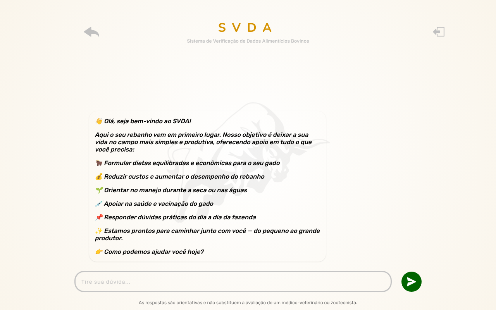
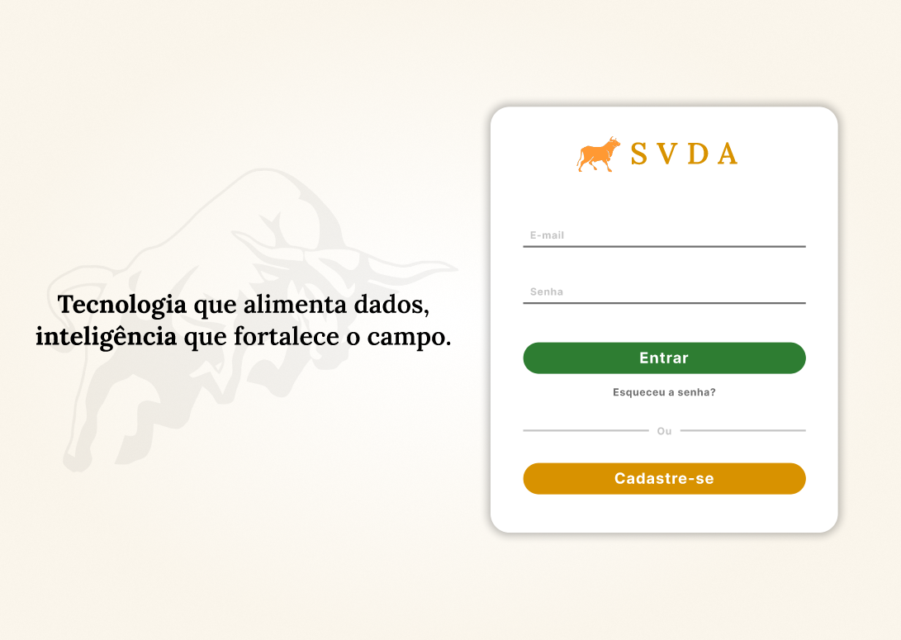
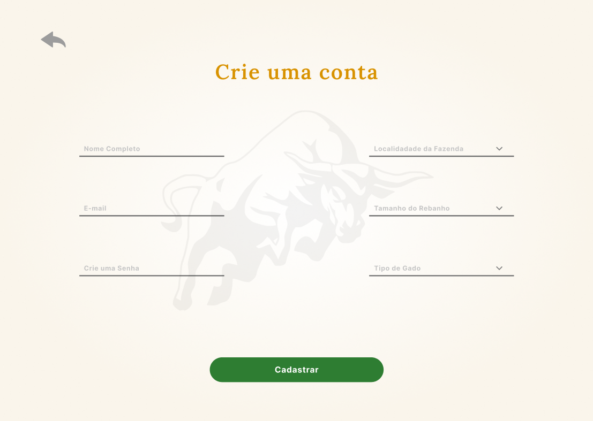
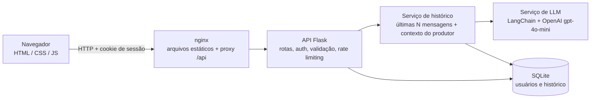

# SVDA

**Um chatbot que dá orientação prática a pequenos e médios produtores de gado sobre alimentação, saúde e manejo do rebanho, em português simples.**

[](https://github.com/tiagoosm/SVDA_Fetin/actions/workflows/ci.yml)

[](LICENSE)

🇬🇧 [Read in English](README.md)

**SVDA** significa *Sistema de Verificação de Dados Alimentícios Bovinos*. O projeto foi desenvolvido em grupo na **44ª FETIN** (Feira Tecnológica do Inatel). O usuário se cadastra com o perfil do rebanho (tipo e porte), faz login e conversa com um assistente especializado em nutrição, saúde e manejo de bovinos.

> ⚠️ As respostas do assistente são apenas orientativas. Elas **não substituem** um médico-veterinário ou zootecnista.

## Telas

Aplicação em execução (tela de chat):



Mockups da fase de design (a interface final pode diferir um pouco):

| Login | Cadastro |
| --- | --- |
|  |  |
| **Conversas** | **Chat** |
|  |  |

## Funcionalidades

- Cadastro com nome, e-mail, senha, tamanho do rebanho (pequeno / médio / grande) e tipo de gado (leite / corte / outro).
- Login e logout com sessão no servidor (cookie HttpOnly). Cada conversa pertence a um único usuário e não pode ser lida por outro.
- Chat com um assistente baseado em LLM (OpenAI `gpt-4o-mini`) que responde em português simples e direto sobre formulação de dietas, suplementação, manejo na seca e nas águas, vacinação e rotina da fazenda.
- O assistente recebe uma linha de contexto sobre o produtor (tipo de gado e porte do rebanho), vinda apenas de listas fechadas.
- O histórico fica salvo no SQLite; é possível listar e reabrir conversas anteriores. Uma nova conversa começa com o contexto limpo.
- Respostas em markdown renderizadas com segurança (sanitizadas com DOMPurify) e efeito de digitação.
- Aviso visível no chat de que as respostas são orientativas e não substituem um profissional.

## Tecnologias

| Camada | Tecnologia |
| --- | --- |
| Frontend | HTML, CSS e JavaScript (sem framework), [marked](https://marked.js.org/) e [DOMPurify](https://github.com/cure53/DOMPurify) (incluídos no repositório) |
| API | Python, Flask, Flask-CORS, Flask-Limiter, gunicorn |
| Camada de LLM | LangChain (`langchain-core`, `langchain-openai`), OpenAI `gpt-4o-mini` |
| Banco de dados | SQLite |
| Ferramentas | pytest, pytest-cov, ruff, GitHub Actions, Docker Compose, nginx |
| Design | Figma |

## Arquitetura



Sem Docker, o navegador conversa direto com a API Flask, e os arquivos estáticos podem ser servidos por qualquer servidor web. Cada requisição a `/mensagem` faz exatamente **uma** chamada ao modelo.

## Como rodar

Você precisa de Python 3.12+ e de uma [chave da API da OpenAI](https://platform.openai.com/api-keys). A API da OpenAI é paga; veja [Controle de custo](#decisões-técnicas).

### Local

```bash
git clone https://github.com/tiagoosm/SVDA_Fetin.git
cd SVDA_Fetin
python -m venv .venv && source .venv/bin/activate
pip install -r requirements.txt
cp .env.example .env        # depois defina OPENAI_API_KEY no .env
python -m api               # API em http://localhost:5000
```

Em um segundo terminal, sirva o frontend:

```bash
python -m http.server 8080 --directory interface
```

Abra <http://localhost:8080>. Em desenvolvimento (`APP_ENV=development`, valor do `.env.example`), se `SECRET_KEY` ficar vazia o servidor gera uma chave aleatória, então as sessões se perdem a cada reinício.

### Docker

```bash
cp .env.example .env        # defina OPENAI_API_KEY e SECRET_KEY
docker compose up --build
```

Abra <http://localhost:8080>. O nginx serve o frontend e faz proxy de `/api/` para o backend, então não há configuração de CORS. Os dados ficam no volume `svda-data`. Gere uma chave com `python -c "import secrets; print(secrets.token_hex(32))"`. Ao servir por HTTPS, defina `SESSION_COOKIE_SECURE=true`.

## Variáveis de ambiente

Todas são opcionais em desenvolvimento, exceto a chave da OpenAI. A lista completa e comentada está em [`.env.example`](.env.example).

| Variável | Padrão | Função |
| --- | --- | --- |
| `OPENAI_API_KEY` | – | Chave da OpenAI para o chatbot (nunca versione) |
| `SECRET_KEY` | – | Assina o cookie de sessão. **Obrigatória** com `APP_ENV=production` |
| `APP_ENV` | `production` | `production`, `development` ou `testing` |
| `DATABASE_PATH` | `banco.db` | Arquivo SQLite (caminhos relativos partem da raiz do projeto) |
| `CORS_ORIGINS` | origens de dev | Origens do frontend permitidas, separadas por vírgula (`*` é recusado) |
| `SESSION_COOKIE_SAMESITE` / `SESSION_COOKIE_SECURE` | `Lax` / `true` em produção | Flags do cookie de sessão |
| `HISTORY_MAX_MESSAGES` | `10` | Mensagens anteriores enviadas ao modelo |
| `MAX_MESSAGE_CHARS` | `2000` | Tamanho máximo de uma mensagem do usuário |
| `LLM_MAX_TOKENS` | `1024` | Máximo de tokens em cada resposta |
| `RATE_LIMIT_LOGIN` / `RATE_LIMIT_REGISTER` / `RATE_LIMIT_MESSAGE` | `5 per minute;30 per hour` / `10 per hour` / `10 per minute;200 per day` | Limites de requisições (`/mensagem` é limitada por usuário) |
| `LOG_FORMAT`, `LOG_LEVEL` | `text`, `INFO` | `LOG_FORMAT=json` imprime um objeto JSON por linha |

O frontend encontra a API por meio de [`interface/config.js`](interface/config.js) (único lugar onde a URL da API é definida).

## API

| Método | Rota | Auth | Descrição |
| --- | --- | --- | --- |
| POST | `/register` | – | Cria a conta (e-mail, senha, nome, porte do rebanho, tipo de gado) |
| POST | `/login` | – | Inicia a sessão |
| POST | `/logout` | ✔ | Encerra a sessão |
| GET | `/me` | ✔ | Perfil do usuário atual |
| POST | `/mensagem` | ✔ | Envia uma mensagem; devolve a resposta e o `conversa_id` |
| GET | `/conversas` | ✔ | Lista as conversas do usuário |
| GET | `/historico?conversa_id=…` | ✔ | Mensagens de uma conversa |

O usuário vem sempre da sessão, nunca de parâmetros da requisição. Os erros são JSON: `{"erro": "..."}`.

## Testes e qualidade

```bash
pip install -r requirements-dev.txt
pytest --cov=api            # 69 testes, ~97% de cobertura
ruff check . && ruff format --check .
```

Os testes nunca chamam a OpenAI: o LLM é substituído por um falso que registra as mensagens recebidas. Eles cobrem cadastro e login, controle de acesso (incluindo o teste de regressão de que o usuário A não lê os dados do usuário B), validação de entrada, rate limiting, limite de histórico, o formato exato das mensagens enviadas ao modelo, a camada de dados e o tratamento de erros. O CI (GitHub Actions) roda lint e testes a cada push e pull request.

## Estrutura do projeto

```text
api/
  __init__.py          app factory create_app()
  config.py            variáveis de ambiente, validadas na inicialização
  security.py          login_required e validação de entrada
  routes/              blueprints de auth, chat e conversas
  services/            llm (prompt + chamada ao modelo) e history (memória, contexto do produtor)
  db/                  conexão, schema/migrações e repositórios
  prompts/system_prompt.md
interface/             frontend estático (páginas, config.js, api.js, vendor/)
tests/                 suíte pytest
docs/                  guia visual, notas de design e screenshots
docker/                configuração do nginx e imagem do frontend
.github/workflows/     CI
```

## Decisões técnicas

- **Sessão no servidor.** O navegador guarda apenas um cookie HttpOnly; quem decide o usuário é o servidor. Uma versão inicial confiava em um ID de usuário enviado pelo cliente, o que permitia ler o histórico de outras pessoas. Isso agora tem teste de regressão.
- **Memória da conversa reconstruída do banco.** O contexto do modelo é montado por (usuário, conversa) a partir da tabela `historico`, então sobrevive a reinícios e uma nova conversa não herda a anterior.
- **Controle de custo.** A API da OpenAI é paga, então cada requisição tem limites: só as últimas `HISTORY_MAX_MESSAGES` mensagens são enviadas, a mensagem do usuário é limitada a `MAX_MESSAGE_CHARS`, a resposta a `LLM_MAX_TOKENS`, e login e `/mensagem` têm rate limiting. Há exatamente uma chamada ao modelo por mensagem, sem chamadas extras (títulos, resumos, moderação).
- **Sem injeção de prompt pelo perfil.** Tipo de gado e porte do rebanho são validados contra listas fechadas antes de chegarem ao prompt.
- **Padrões seguros.** Debug desligado, servidor em `127.0.0.1`, CORS com lista de origens permitidas, e o app se recusa a iniciar em produção sem `SECRET_KEY`.

## Limitações conhecidas

- O assistente usa uma API de LLM paga de terceiros e precisa de internet e de uma chave de API.
- O conhecimento dele é um prompt de sistema estático, não um sistema de busca. O conteúdo técnico (por exemplo, a orientação de vacinação) **não foi validado por um médico-veterinário** e pode estar desatualizado.
- O rate limiter em memória é por processo; com mais de um processo, use Redis (`RATELIMIT_STORAGE_URI`).
- Não há recuperação de senha nem verificação de e-mail.
- O SQLite serve para demonstração ou uso pequeno, não para alta concorrência.
- As respostas chegam inteiras e são "digitadas" no navegador; não há streaming.
- O código do frontend não tem testes automatizados; foi verificado manualmente em um navegador.

## Roadmap

Ideias, não compromissos:

- Hospedar o backend e publicar uma demo online.
- Revisar o conteúdo técnico do assistente com um profissional e manter o calendário de vacinação atualizado.
- Recuperação de senha e o campo "localidade" previsto no design original do cadastro.
- Respostas em streaming.
- Rate limiting com Redis e banco de dados de produção.
- Testes automatizados do frontend.

## Licença

[MIT](LICENSE) © Tiago da Silva Machado
